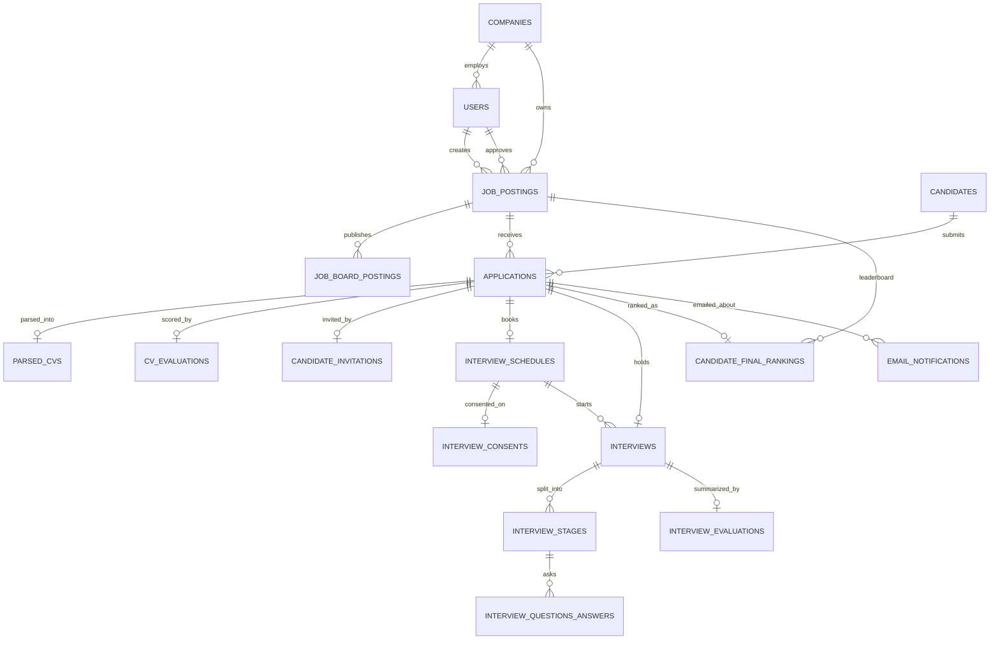

# AutoHR database architecture

PostgreSQL database **`autohr_n`** on `localhost:5432`. It follows the hiring schema in `C:\Users\A\Downloads\AutoHR` and adds the structural fixes listed below. The database is empty: tables, keys, checks, and indexes only. No demo rows were inserted.

The script that was applied is [`db/schema.sql`](db/schema.sql). The existing database `autohr_db` was not changed.

Database timezone: `Asia/Karachi`.

## What changed from the original schema

| Change | Why |
| --- | --- |
| New `companies` table | Company profile and Rozee, Indeed, and LinkedIn credentials belong to the employer, not copied onto every HR user |
| `users.company_id` | An HR user belongs to one company |
| `job_postings.company_id`, `department`, `city` | Matches the dashboard: a role has a department and a Pakistani city, and belongs to the company |
| Salary currency defaults to `PKR` | This product is built for Pakistan |
| `interview_status_enum` and `notification_status_enum` | Interview and email status were free text. They are now fixed values |
| One `decision_verdict_enum` | The HR override uses the same verdict list as the AI decision |
| Score, salary, rank, and time checks | Invalid scores and inverted salary or schedule ranges are rejected by the database |
| `updated_at` trigger | `updated_at` changes on every update, not only when the application remembers to set it |
| Company and ranking triggers | A job cannot be filed under another company. A ranking cannot point at a different job than its application |
| Interview transcript may be empty at first | A question row can exist before Whisper has produced the transcript |
| Consent may be recorded as refused | A declined recording or AI-processing consent is stored. The interview must still not start unless both values are true |
| Schedule timezone defaults to `Asia/Karachi` | Local hiring hours |

Everything else is the same pipeline: users, jobs, board posts, candidates, applications, parsed CVs, CV scores, invitations, schedules, consent, interviews, three stages, question scores, interview scorecards, final rankings, and email notifications.

## How the data fits together

Delete behavior:

- Deleting a **company** is blocked while it still has users or jobs (`RESTRICT`).
- Deleting a **user** is blocked while they still have jobs they created. If they only approved a job, that approval is cleared (`SET NULL`).
- Deleting a **job** deletes its board posts, applications, and rankings.
- Deleting an **application** deletes its CV parse, CV score, invitation, schedule, interview, and ranking. Sent emails keep their row and lose the application link (`SET NULL`).
- Deleting an **interview schedule** is blocked while an interview still points at it.

## Design rules

- Primary keys are UUID, generated with `gen_random_uuid()`.
- Names are `snake_case`. Table names are plural.
- Emails use `CITEXT`, so `HR@Company.pk` and `hr@company.pk` are the same address.
- Timestamps are `TIMESTAMPTZ`.
- Scores that are queried and sorted are normal numeric columns. AI payloads that change shape (parsed profile, skill match detail, board API response, JD prompt) are `JSONB`.
- Job-board passwords are `TEXT` columns meant to hold ciphertext produced by the application. The database does not store those passwords in clear text by itself; the application must encrypt them before insert.
- HR login passwords are stored only as `password_hash`.

## Enums

| Type | Values |
| --- | --- |
| `user_role_enum` | `admin`, `hr_manager`, `interviewer` |
| `job_status_enum` | `draft`, `pending_approval`, `approved`, `published`, `paused`, `closed` |
| `job_board_platform_enum` | `indeed`, `rozee_pk`, `linkedin`, `custom_career_page` |
| `board_sync_status_enum` | `pending`, `published`, `failed`, `expired` |
| `application_source_enum` | `email_inbound`, `web_form`, `indeed`, `rozee_pk`, `manual_upload` |
| `application_status_enum` | `applied`, `parsing_cv`, `screened`, `shortlisted`, `rejected`, `interview_invited`, `interview_scheduled`, `interview_in_progress`, `interview_completed`, `final_review`, `hired`, `archived` |
| `interview_stage_type_enum` | `screening`, `technical`, `behavioral` |
| `stage_status_enum` | `not_started`, `in_progress`, `completed`, `skipped` |
| `interview_status_enum` | `pending`, `in_progress`, `completed`, `cancelled`, `no_show` |
| `media_retention_enum` | `active`, `marked_for_deletion`, `purged` |
| `decision_verdict_enum` | `strong_hire`, `hire`, `lean_hire`, `no_hire` |
| `notification_type_enum` | `rejection`, `interview_invite`, `interview_reminder`, `hr_status_update` |
| `notification_status_enum` | `queued`, `sent`, `failed` |

## Tables

Columns marked **yes** in Required cannot be null. Defaults are applied when the insert omits the column.

### `companies`

The employer. One company has many HR users and many jobs. LinkedIn, Indeed, and Rozee credentials are stored once.

| Column | Type | Required | Default | Notes |
| --- | --- | --- | --- | --- |
| `id` | UUID | yes | `gen_random_uuid()` | Primary key |
| `name` | VARCHAR(200) | yes | | |
| `website` | VARCHAR(300) | | | |
| `industry` | VARCHAR(120) | | | |
| `company_size` | VARCHAR(40) | | | Example: `51-200` |
| `country` | VARCHAR(80) | yes | `Pakistan` | |
| `city` | VARCHAR(80) | | | |
| `office_address` | VARCHAR(300) | | | |
| `linkedin_profile_url` | VARCHAR(300) | | | |
| `linkedin_email` | CITEXT | | | |
| `linkedin_password_encrypted` | TEXT | | | Ciphertext only |
| `indeed_email` | CITEXT | | | |
| `indeed_password_encrypted` | TEXT | | | Ciphertext only |
| `rozee_email` | CITEXT | | | |
| `rozee_password_encrypted` | TEXT | | | Ciphertext only |
| `created_at` | TIMESTAMPTZ | yes | now | |
| `updated_at` | TIMESTAMPTZ | yes | now | Trigger on update |

Relations: referenced by `users.company_id` and `job_postings.company_id`.

### `users`

An HR person, admin, or interviewer who signs in.

| Column | Type | Required | Default | Notes |
| --- | --- | --- | --- | --- |
| `id` | UUID | yes | random UUID | Primary key |
| `company_id` | UUID | yes | | FK `companies.id`, delete restricted |
| `email` | CITEXT | yes | | Unique |
| `full_name` | VARCHAR(150) | yes | | |
| `password_hash` | VARCHAR(255) | yes | | Never the raw password |
| `phone` | VARCHAR(30) | | | |
| `job_title` | VARCHAR(120) | | | Example: HR Manager |
| `role` | `user_role_enum` | yes | `hr_manager` | |
| `is_active` | BOOLEAN | yes | `true` | |
| `created_at` | TIMESTAMPTZ | yes | now | |
| `updated_at` | TIMESTAMPTZ | yes | now | Trigger on update |

Relations: belongs to one company. Creates jobs through `job_postings.created_by`. Approves jobs through `job_postings.approved_by`.

### `job_postings`

Step 1 and step 2 of the pipeline: the role, the salary band, the skills, and the approved job description.

| Column | Type | Required | Default | Notes |
| --- | --- | --- | --- | --- |
| `id` | UUID | yes | random UUID | Primary key |
| `company_id` | UUID | yes | | FK `companies.id`, delete restricted |
| `created_by` | UUID | yes | | FK `users.id`, delete restricted |
| `approved_by` | UUID | | | FK `users.id`, set null if that user is removed |
| `title` | VARCHAR(200) | yes | | |
| `department` | VARCHAR(120) | | | |
| `city` | VARCHAR(80) | | | |
| `min_experience_years` | INT | yes | `0` | Must be `>= 0` |
| `max_experience_years` | INT | | | Null, or `>= min_experience_years` |
| `min_salary` | NUMERIC(12,2) | | | Null, or `>= 0`. Monthly amount |
| `max_salary` | NUMERIC(12,2) | | | Null, or `>= min_salary` |
| `currency` | CHAR(3) | yes | `PKR` | |
| `target_hires` | INT | yes | `1` | Must be `> 0` |
| `shortlist_multiplier` | NUMERIC(4,2) | yes | `3.0` | Must be `>= 1`. Shortlist size is about `target_hires * multiplier` |
| `required_skills` | TEXT[] | yes | `{}` | |
| `bonus_skills` | TEXT[] | yes | `{}` | |
| `ai_jd_prompt_payload` | JSONB | | | Inputs sent to the model |
| `ai_generated_jd_draft` | TEXT | | | Draft before HR approval |
| `approved_jd_content` | TEXT | | | Description HR approved |
| `status` | `job_status_enum` | yes | `draft` | |
| `approved_at` | TIMESTAMPTZ | | | |
| `created_at` | TIMESTAMPTZ | yes | now | |
| `updated_at` | TIMESTAMPTZ | yes | now | Trigger on update |

Trigger `enforce_job_company`: `company_id` must be the creating user's company. If `approved_by` is set, that user must belong to the same company.

Relations: owned by one company; created by one user; optionally approved by one user. Has many `job_board_postings`, `applications`, and `candidate_final_rankings`.

### `job_board_postings`

Step 3. One row per job per board. A job cannot be posted twice to the same platform (`uq_job_platform`).

| Column | Type | Required | Default | Notes |
| --- | --- | --- | --- | --- |
| `id` | UUID | yes | random UUID | Primary key |
| `job_posting_id` | UUID | yes | | FK `job_postings.id`, cascade delete |
| `platform` | `job_board_platform_enum` | yes | | |
| `external_job_id` | VARCHAR(255) | | | Id returned by the board |
| `post_url` | TEXT | | | Public posting URL |
| `sync_status` | `board_sync_status_enum` | yes | `pending` | |
| `response_payload` | JSONB | | | Raw board response |
| `error_message` | TEXT | | | |
| `published_at` | TIMESTAMPTZ | | | |
| `expires_at` | TIMESTAMPTZ | | | |
| `created_at` | TIMESTAMPTZ | yes | now | |
| `updated_at` | TIMESTAMPTZ | yes | now | Trigger on update |

### `candidates`

A person who can apply to more than one job. Email is unique across the whole database.

| Column | Type | Required | Default | Notes |
| --- | --- | --- | --- | --- |
| `id` | UUID | yes | random UUID | Primary key |
| `email` | CITEXT | yes | | Unique |
| `full_name` | VARCHAR(200) | yes | | |
| `phone` | VARCHAR(50) | | | |
| `linkedin_url` | TEXT | | | |
| `location` | VARCHAR(150) | | | City or city and country |
| `created_at` | TIMESTAMPTZ | yes | now | |
| `updated_at` | TIMESTAMPTZ | yes | now | Trigger on update |

Relations: one candidate has many `applications`.

### `applications`

Step 4. One candidate can apply once to a given job (`uq_job_candidate`).

| Column | Type | Required | Default | Notes |
| --- | --- | --- | --- | --- |
| `id` | UUID | yes | random UUID | Primary key |
| `job_posting_id` | UUID | yes | | FK `job_postings.id`, cascade delete |
| `candidate_id` | UUID | yes | | FK `candidates.id`, cascade delete |
| `source` | `application_source_enum` | yes | `web_form` | |
| `source_message_id` | VARCHAR(255) | | | Inbound email Message-ID, when the source is email |
| `resume_file_url` | TEXT | yes | | Storage path of the CV file |
| `resume_original_filename` | VARCHAR(255) | yes | | |
| `resume_mime_type` | VARCHAR(100) | yes | | |
| `status` | `application_status_enum` | yes | `applied` | Moves forward through screen, interview, and decision |
| `created_at` | TIMESTAMPTZ | yes | now | |
| `updated_at` | TIMESTAMPTZ | yes | now | Trigger on update |

Relations, each at most one row except email: `parsed_cvs`, `cv_evaluations`, `candidate_invitations`, `interview_schedules`, `interviews`, `candidate_final_rankings`. Many `email_notifications`.

### `parsed_cvs`

Step 5. The structured read of one resume. One row per application.

| Column | Type | Required | Default | Notes |
| --- | --- | --- | --- | --- |
| `id` | UUID | yes | random UUID | Primary key |
| `application_id` | UUID | yes | | FK `applications.id`, unique, cascade delete |
| `raw_text` | TEXT | yes | | Extracted resume text |
| `structured_profile` | JSONB | yes | | Work history, education, certifications |
| `extracted_skills` | TEXT[] | yes | `{}` | |
| `extracted_experience_years` | NUMERIC(4,1) | | | Null, or `>= 0` |
| `highest_degree` | VARCHAR(150) | | | |
| `parsing_model` | VARCHAR(100) | yes | | Model name that parsed the file |
| `parsed_at` | TIMESTAMPTZ | yes | now | |

### `cv_evaluations`

Step 5 and step 6. Scores against the job. All four scores are 0 to 100. One row per application.

| Column | Type | Required | Default | Notes |
| --- | --- | --- | --- | --- |
| `id` | UUID | yes | random UUID | Primary key |
| `application_id` | UUID | yes | | FK `applications.id`, unique, cascade delete |
| `overall_score` | NUMERIC(5,2) | yes | | 0–100 |
| `skill_match_score` | NUMERIC(5,2) | yes | | 0–100 |
| `experience_match_score` | NUMERIC(5,2) | yes | | 0–100 |
| `education_match_score` | NUMERIC(5,2) | yes | | 0–100 |
| `match_breakdown` | JSONB | yes | `{}` | Matched and missing skills |
| `ai_summary` | TEXT | yes | | Short reason shown to HR |
| `strengths` | TEXT[] | yes | `{}` | |
| `concerns` | TEXT[] | yes | `{}` | |
| `is_shortlisted` | BOOLEAN | yes | `false` | Set in the shortlist step |
| `evaluated_at` | TIMESTAMPTZ | yes | now | |

### `candidate_invitations`

Step 6. One magic link per shortlisted application.

| Column | Type | Required | Default | Notes |
| --- | --- | --- | --- | --- |
| `id` | UUID | yes | random UUID | Primary key |
| `application_id` | UUID | yes | | FK `applications.id`, unique, cascade delete |
| `magic_token` | VARCHAR(128) | yes | | Unique |
| `expires_at` | TIMESTAMPTZ | yes | | |
| `is_used` | BOOLEAN | yes | `false` | |
| `sent_at` | TIMESTAMPTZ | yes | now | |
| `accepted_at` | TIMESTAMPTZ | | | Set when the candidate opens the link and books |

### `interview_schedules`

Step 7. One booked slot per application. End must be after start.

| Column | Type | Required | Default | Notes |
| --- | --- | --- | --- | --- |
| `id` | UUID | yes | random UUID | Primary key |
| `application_id` | UUID | yes | | FK `applications.id`, unique, cascade delete |
| `scheduled_start` | TIMESTAMPTZ | yes | | |
| `scheduled_end` | TIMESTAMPTZ | yes | | Must be after `scheduled_start` |
| `timezone` | VARCHAR(50) | yes | `Asia/Karachi` | |
| `room_url` | TEXT | | | Candidate interview link |
| `is_rescheduled` | BOOLEAN | yes | `false` | |
| `created_at` | TIMESTAMPTZ | yes | now | |

Relations: one `interview_consents` row. An `interviews` row points back here and blocks deletion of the schedule.

### `interview_consents`

Step 7 audit of recording and AI-processing consent. One row per schedule.

| Column | Type | Required | Default | Notes |
| --- | --- | --- | --- | --- |
| `id` | UUID | yes | random UUID | Primary key |
| `interview_schedule_id` | UUID | yes | | FK `interview_schedules.id`, unique, cascade delete |
| `consent_recording` | BOOLEAN | yes | | `false` is allowed so a refusal is kept |
| `consent_ai_processing` | BOOLEAN | yes | | Same as above |
| `ip_address` | INET | yes | | |
| `user_agent` | TEXT | yes | | |
| `consented_at` | TIMESTAMPTZ | yes | now | |

The application must refuse to start an interview unless both consent flags are true.

### `interviews`

Step 8. One interview session per application.

| Column | Type | Required | Default | Notes |
| --- | --- | --- | --- | --- |
| `id` | UUID | yes | random UUID | Primary key |
| `application_id` | UUID | yes | | FK `applications.id`, unique, cascade delete |
| `interview_schedule_id` | UUID | yes | | FK `interview_schedules.id`, delete restricted |
| `status` | `interview_status_enum` | yes | `pending` | |
| `recording_url` | TEXT | | | Cleared after a purge |
| `recording_file_size_bytes` | BIGINT | | | Null, or `>= 0` |
| `media_retention_status` | `media_retention_enum` | yes | `active` | |
| `media_purged_at` | TIMESTAMPTZ | | | |
| `started_at` | TIMESTAMPTZ | | | |
| `ended_at` | TIMESTAMPTZ | | | If both times are set, end is not before start |
| `created_at` | TIMESTAMPTZ | yes | now | |

Relations: many `interview_stages`. One `interview_evaluations` row.

### `interview_stages`

The three stages, in order: 1 screening, 2 technical, 3 behavioral. An interview cannot repeat a stage type or a sequence number.

| Column | Type | Required | Default | Notes |
| --- | --- | --- | --- | --- |
| `id` | UUID | yes | random UUID | Primary key |
| `interview_id` | UUID | yes | | FK `interviews.id`, cascade delete |
| `stage_type` | `interview_stage_type_enum` | yes | | Unique per interview |
| `sequence_order` | INT | yes | | `1`, `2`, or `3`. Unique per interview |
| `status` | `stage_status_enum` | yes | `not_started` | |
| `started_at` | TIMESTAMPTZ | | | |
| `ended_at` | TIMESTAMPTZ | | | |

Relations: many `interview_questions_answers`.

### `interview_questions_answers`

Step 9. One row per question inside a stage. The five dimension scores are each 0 to 10.

| Column | Type | Required | Default | Notes |
| --- | --- | --- | --- | --- |
| `id` | UUID | yes | random UUID | Primary key |
| `stage_id` | UUID | yes | | FK `interview_stages.id`, cascade delete |
| `question_number` | INT | yes | | `> 0`. Unique inside the stage |
| `question_text` | TEXT | yes | | |
| `audio_clip_url` | TEXT | | | |
| `transcript_text` | TEXT | | | Filled after transcription |
| `duration_seconds` | INT | | | Null, or `>= 0` |
| `communication_score` | NUMERIC(4,2) | | | 0–10 |
| `confidence_score` | NUMERIC(4,2) | | | 0–10 |
| `technical_score` | NUMERIC(4,2) | | | 0–10 |
| `relevance_score` | NUMERIC(4,2) | | | 0–10 |
| `problem_solving_score` | NUMERIC(4,2) | | | 0–10 |
| `ai_rationale` | TEXT | | | Why this answer received those scores |
| `created_at` | TIMESTAMPTZ | yes | now | |

### `interview_evaluations`

Step 9 rollup. Averages of the five dimensions (0–10) and one interview score out of 100. One row per interview.

| Column | Type | Required | Default | Notes |
| --- | --- | --- | --- | --- |
| `id` | UUID | yes | random UUID | Primary key |
| `interview_id` | UUID | yes | | FK `interviews.id`, unique, cascade delete |
| `communication_avg` | NUMERIC(4,2) | yes | | 0–10 |
| `confidence_avg` | NUMERIC(4,2) | yes | | 0–10 |
| `technical_avg` | NUMERIC(4,2) | yes | | 0–10 |
| `relevance_avg` | NUMERIC(4,2) | yes | | 0–10 |
| `problem_solving_avg` | NUMERIC(4,2) | yes | | 0–10 |
| `composite_interview_score` | NUMERIC(5,2) | yes | | 0–100 |
| `strengths` | TEXT[] | yes | `{}` | |
| `weaknesses` | TEXT[] | yes | `{}` | |
| `executive_summary` | TEXT | yes | | |
| `evaluated_at` | TIMESTAMPTZ | yes | now | |

### `candidate_final_rankings`

Step 10. One rank per application, and one application cannot occupy two ranks on the same job. `final_rank` is unique per job, so a recalculation must update existing rows rather than insert a second rank 1.

| Column | Type | Required | Default | Notes |
| --- | --- | --- | --- | --- |
| `id` | UUID | yes | random UUID | Primary key |
| `job_posting_id` | UUID | yes | | FK `job_postings.id`, cascade delete |
| `application_id` | UUID | yes | | FK `applications.id`, unique, cascade delete |
| `final_rank` | INT | yes | | `> 0`. Unique with `job_posting_id` |
| `cv_score` | NUMERIC(5,2) | yes | | 0–100 |
| `interview_score` | NUMERIC(5,2) | yes | | 0–100 |
| `composite_score` | NUMERIC(5,2) | yes | | 0–100 |
| `decision_verdict` | `decision_verdict_enum` | yes | | AI verdict |
| `ai_justification` | TEXT | yes | | Reason shown on the dashboard |
| `recording_retained` | BOOLEAN | yes | `false` | True only for candidates whose recording is kept |
| `hr_override_verdict` | `decision_verdict_enum` | | | Set when HR disagrees |
| `hr_feedback_notes` | TEXT | | | |
| `calculated_at` | TIMESTAMPTZ | yes | now | |

Trigger `enforce_ranking_job`: `job_posting_id` must be the job on that application.

Suggested retention rule, same as the original design: for a job with `target_hires = N`, keep recordings for ranks `1` through `N * 1.5`. Set `recording_retained` accordingly. A daily worker can then select active recordings whose rank is not retained and whose `calculated_at` is older than 14 days, delete the file from storage, and set `media_retention_status = 'purged'`, `media_purged_at`, and `recording_url = NULL`. Transcripts and scores stay.

### `email_notifications`

Rejection mail, interview invites, reminders, and HR status mail.

| Column | Type | Required | Default | Notes |
| --- | --- | --- | --- | --- |
| `id` | UUID | yes | random UUID | Primary key |
| `application_id` | UUID | | | FK `applications.id`, set null if the application is deleted |
| `recipient_email` | CITEXT | yes | | |
| `notification_type` | `notification_type_enum` | yes | | |
| `subject` | VARCHAR(255) | yes | | |
| `body_text` | TEXT | yes | | |
| `status` | `notification_status_enum` | yes | `queued` | |
| `external_provider_id` | VARCHAR(255) | | | Id from the mail provider |
| `error_message` | TEXT | | | |
| `sent_at` | TIMESTAMPTZ | | | |
| `created_at` | TIMESTAMPTZ | yes | now | |

## Indexes

| Index | Table | Purpose |
| --- | --- | --- |
| `idx_users_company_id` | `users` | HR people in one company |
| `idx_job_postings_company_id` | `job_postings` | A company's roles |
| `idx_job_postings_status` | `job_postings` | Live, draft, and closed filters |
| `idx_job_postings_city` | `job_postings` | City filter on the jobs screen |
| `idx_job_postings_req_skills_gin` | `job_postings` | Skill array search |
| `idx_job_board_postings_status` | `job_board_postings` | Board sync status for one job |
| `idx_candidates_email` | `candidates` | Lookup by email |
| `idx_applications_job_id_status` | `applications` | Pipeline counts per job |
| `idx_applications_candidate_id` | `applications` | Every application from one person |
| `idx_parsed_cvs_profile_gin` | `parsed_cvs` | JSON profile search |
| `idx_parsed_cvs_skills_gin` | `parsed_cvs` | Skill array search |
| `idx_cv_evaluations_overall_score` | `cv_evaluations` | Highest CV scores first |
| `idx_cv_evaluations_shortlisted` | `cv_evaluations` | Shortlist filter |
| `idx_candidate_invitations_token` | `candidate_invitations` | Magic-link lookup |
| `idx_interviews_retention` | `interviews` | Partial index of recordings still `active` |
| `idx_final_rankings_leaderboard` | `candidate_final_rankings` | Rank order for one job |
| `idx_final_rankings_score` | `candidate_final_rankings` | Highest composite score for one job |
| `idx_email_notifications_recipient` | `email_notifications` | Mail sent to one address |
| `idx_email_notifications_application` | `email_notifications` | Mail for one application |

Unique indexes created by the unique constraints are in addition to this list.

## Pipeline map

| Step | What happens | Tables written |
| --- | --- | --- |
| Account | HR registers a company and signs in | `companies`, `users` |
| 1 | HR enters the role | `job_postings` |
| 2 | AI drafts a description; HR approves it | `job_postings` |
| 3 | The role is sent to Rozee, Indeed, or LinkedIn | `job_board_postings` |
| 4 | A resume arrives | `candidates`, `applications` |
| 5 | The CV is parsed and scored | `parsed_cvs`, `cv_evaluations` |
| 6 | Shortlist and invite | `cv_evaluations.is_shortlisted`, `candidate_invitations`, `email_notifications` |
| 7 | Candidate books a time and consents | `interview_schedules`, `interview_consents` |
| 8 | Screening, technical, and behavioral stages run | `interviews`, `interview_stages` |
| 9 | Each answer is scored on five dimensions, then averaged | `interview_questions_answers`, `interview_evaluations` |
| 10 | CV score and interview score become a rank and a verdict | `candidate_final_rankings` |

The Django screens in this repository still read the static demo file `Frontend/portal/data.py`. They are not connected to `autohr_n` yet.
