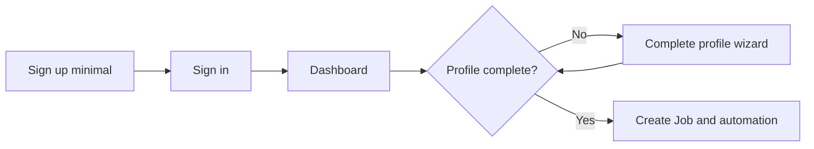

# Auth, signup, login, and profile completion (spec)

This document defines **what to build next** for real accounts in AutoHR-N: **email + password only** (no phone login, no Google/social login). Registration creates an account quickly; **automation credentials and company details are completed in a profile wizard** before the user can post their **first job**.

---

## Principles

| Rule | Detail |
| --- | --- |
| Sign-in method | **Work email + password** only |
| Not in scope (v1) | Phone OTP login, Google/Microsoft social login, magic links |
| Phone number | Collected for **contact / notifications**, not as login ID |
| Secrets | Passwords and API tokens stored **encrypted** (app-layer); never log raw values |
| Multi-tenant | One **company** row; one or more **users** per company; jobs belong to `company_id` |
| Gate | **`profile_complete = false`** until required profile sections pass validation → block **Create Job** / **Generate Job Description** |

---

## User journey (high level)



After signup, the user may **sign in** and explore the dashboard, but **posting the first job** shows a banner/modal: *Complete your company profile and integrations to enable hiring automation.*

---

## Phase 1 — Sign up (minimal account creation)

**Goal:** Create `companies` + `users` rows with the least friction. Do **not** collect every API key on this screen.

### Recommended signup fields

| Field | Required | Stored in | Notes |
| --- | --- | --- | --- |
| Work email | Yes | `users.email` | Unique; becomes login ID |
| Password | Yes | `users.password_hash` | Min 8 chars, at least 1 letter + 1 number |
| Confirm password | Yes | — | Client + server match |
| Full name | Yes | `users.full_name` | HR contact name |
| Company name | Yes | `companies.name` | Creates company on register |
| Accept terms & privacy | Yes | `users.accepted_terms_at` (new) | Timestamp + version string |

### Optional on signup (your choice — can defer to profile)

| Field | Stored in | Notes |
| --- | --- | --- |
| Work phone | `users.phone` | E.164 or `+92 …` validated |
| Job title | `users.job_title` | e.g. HR Manager |
| Country | `companies.country` | Default `Pakistan` |
| City | `companies.city` | Dropdown PK cities |

### Explicitly **not** on signup (move to profile wizard)

- LinkedIn / Indeed / Rozee passwords  
- Google service account / OAuth  
- Google Drive folder IDs  
- Google Forms / Meet settings  
- SMTP / SendGrid keys  

### Signup API (planned)

- `POST /api/auth/register/` or `POST /register/`  
- Transaction: insert `companies` → insert `users` with `role = hr_manager`, `profile_complete = false`  
- Auto sign-in (session) or redirect to login with success message  

### Validation

- Email format + unique  
- Password strength policy  
- Company name length 2–200  
- Rate-limit registrations per IP (later)  

---

## Phase 2 — Login

**Goal:** Session-based auth tied to real `users` row (replace `ensure_demo_hr()` for logged-in requests).

### Login fields

| Field | Required |
| --- | --- |
| Work email | Yes |
| Password | Yes |
| Remember me | Optional (longer session cookie) |

### Login API (planned)

- `POST /api/auth/login/`  
- Verify `password_hash` (Django `make_password` / `check_password` or Argon2)  
- Set session: `user_id`, `company_id`  
- Redirect: dashboard; if `profile_complete = false`, highlight **Account / Complete profile**  

### Logout

- `POST /logout/` — destroy session  

### Password reset (later, document now)

- Forgot password → email reset link (needs outbound email in profile)  

---

## Phase 3 — Complete profile (before first job)

**Goal:** One guided wizard (or Account panel with sections and progress %) collecting **company**, **job boards**, and **Google / email automation** data.

### Completion flags (suggested columns)

On **`users`**:

| Column | Type | Purpose |
| --- | --- | --- |
| `profile_complete` | BOOLEAN | Master gate for first job |
| `profile_completed_at` | TIMESTAMPTZ | Audit |
| `email_verified` | BOOLEAN | Optional future |
| `last_login_at` | TIMESTAMPTZ | Security |

On **`companies`**:

| Column | Type | Purpose |
| --- | --- | --- |
| `onboarding_step` | VARCHAR(40) | e.g. `company`, `boards`, `google`, `email`, `done` |
| `profile_completion_pct` | INT | 0–100 for UI |

Alternatively: normalize into **`company_integration_settings`** (one row per company) — recommended for many secrets.

---

### Section A — HR user (account owner)

| Field | Required for automation | DB |
| --- | --- | --- |
| Full name | Yes | `users.full_name` |
| Job title | Yes | `users.job_title` |
| Work email | Yes (from signup) | `users.email` |
| Work phone | Yes | `users.phone` |
| Time zone | Yes | `users.timezone` (new, default `Asia/Karachi`) |
| Preferred language | Optional | `users.locale` (new, default `en`) |

---

### Section B — Company profile

| Field | Required for first job | DB |
| --- | --- | --- |
| Legal / display company name | Yes | `companies.name` |
| Website | Recommended | `companies.website` |
| Industry | Yes | `companies.industry` |
| Company size | Yes | `companies.company_size` |
| Country | Yes | `companies.country` |
| City | Yes | `companies.city` |
| Office address | Recommended | `companies.office_address` |
| Company logo URL | Optional | `companies.logo_url` (new) |
| HR contact public email | Optional | `companies.careers_email` (new) — may differ from login email |
| Company description (short) | Recommended | `companies.about_text` (new) — used in JD / posts |

---

### Section C — Job boards (existing columns + notes)

Used for **job posting** automation (Rozee, Indeed) and **LinkedIn simple post** (announcement, not LinkedIn job slot).

| Integration | Fields | DB (today) | Notes |
| --- | --- | --- | --- |
| LinkedIn company page | Profile URL | `companies.linkedin_profile_url` | |
| LinkedIn login | Email + password | `linkedin_email`, `linkedin_password_encrypted` | For **simple post** automation (browser or API if available) |
| Indeed PK | Email + password | `indeed_email`, `indeed_password_encrypted` | Job syndication |
| Rozee.pk | Email + password | `rozee_email`, `rozee_password_encrypted` | Optional if not used |

**LinkedIn “simple post” (not job post):** store also (new):

| Field | Purpose |
| --- | --- |
| `linkedin_post_as` | `company_page` \| `personal` |
| `linkedin_personal_profile_url` | If posting as person |
| `linkedin_session_notes` | Optional: 2FA hint — “use app password” |

---

### Section D — Google Forms (application form automation)

**Purpose:** Auto-create/update application Google Form per job and later paste link after `Apply Here:`.

| Field | Required | Storage |
| --- | --- | --- |
| Google Cloud project ID | Yes | `company_integrations.google_project_id` |
| Google OAuth client ID | If using OAuth | encrypted JSON or separate columns |
| Google OAuth client secret | If using OAuth | encrypted |
| Google OAuth refresh token | After one-time consent | encrypted |
| **Or** service account JSON | Alternative to OAuth | encrypted blob `google_service_account_json_encrypted` |
| Default form owner email | Yes | `google_forms_owner_email` |
| Form response destination | Yes | `google_form_response_sheet_id` OR `response_drive_folder_id` |
| Default form language | Optional | `en` / `ur` |

**Scopes (document for consent screen):**

- `https://www.googleapis.com/auth/forms.body`
- `https://www.googleapis.com/auth/drive.file` (or broader if needed)

---

### Section E — Google Drive (candidate files)

**Purpose:** Store CVs, interview recordings, exports.

| Field | Required | Storage |
| --- | --- | --- |
| Root folder ID | Yes | `google_drive_root_folder_id` |
| CV uploads subfolder name/pattern | Yes | e.g. `{company_slug}/jobs/{job_id}/cvs/` |
| Interview media subfolder | Yes | `.../interviews/` |
| Shared drive ID | Optional | If using Shared drives |
| Retention days | Optional | Align with `media_retention_enum` in pipeline |

Uses same Google credentials as Section D (one Google connection per company).

---

### Section F — Email (candidate interview invites & status)

**Purpose:** Send schedule links, reminders, rejections.

| Field | Required | Storage |
| --- | --- | --- |
| Provider | Yes | `smtp` \| `sendgrid` \| `mailgun` \| `google_workspace` |
| From name | Yes | e.g. `Northbridge Careers` |
| From email | Yes | Must be authorized on provider |
| Reply-to email | Recommended | HR inbox |
| SMTP host / port / TLS | If SMTP | encrypted |
| SMTP username / password | If SMTP | encrypted |
| SendGrid API key | If SendGrid | encrypted |
| Email signature block | Optional | text/HTML template |

**Templates to configure later (names only in profile):**

- Interview invitation  
- Interview reminder  
- Rejection after CV  
- Rejection after interview  

---

### Section G — Google Meet (interview meetings)

**Purpose:** Create Meet link when scheduling AI/video interview.

| Field | Required | Storage |
| --- | --- | --- |
| Calendar ID | Yes | `google_calendar_id` (often primary email) |
| Create Meet on events | Yes | boolean `google_meet_auto_create` |
| Default interview duration (minutes) | Yes | e.g. 30 |
| Buffer between interviews | Optional | minutes |
| Organizer email | Yes | Must match Google Workspace user used for API |

**Scopes:**

- `https://www.googleapis.com/auth/calendar.events`

Same Google OAuth/service account as D/E when possible.

---

### Section H — AI & screening (already partially in app)

| Field | Required | Storage |
| --- | --- | --- |
| Groq API key | Optional per company | Prefer **platform** key in server `.env`; optional `company.groq_api_key_encrypted` for BYOK |
| Groq model default | Optional | env / company override |
| CV parsing provider | Later | OpenAI / local — document placeholder |

---

### Section I — Legal & compliance (recommended before first publish)

| Field | Required |
| --- | --- |
| Data retention policy acknowledged | Checkbox |
| Candidate consent text version | String |
| EEO statement default | Text (used in JD) |

---

## Profile completion rules (gate for first job)

Define **`profile_complete = true`** only when all **required** subsets pass:

| Block | Minimum required |
| --- | --- |
| A — HR user | full_name, job_title, phone, timezone |
| B — Company | name, industry, size, country, city |
| C — Job boards | At least **one** of: (LinkedIn creds + URL) OR (Indeed creds) OR (Rozee creds) — *product decision* |
| D — Google Forms | Valid Google auth + form owner email |
| E — Google Drive | Root folder ID |
| F — Email | Provider + from address + working credentials |
| G — Google Meet | Calendar ID + auto-create enabled |

**Strict mode (recommended for full automation):** all blocks C–G required.  
**Relaxed mode:** require A + B only to **draft** jobs; require C–G to **publish** or **Post Create Google Form**.

Implement in code:

```python
def company_can_create_job(company, user) -> tuple[bool, list[str]]:
    """Return (ok, list of missing section labels)."""
```

Dashboard **Create Job** checks logged-in user’s company, not `ensure_demo_hr()`.

---

## Suggested new database objects

### Option 1 — Extend `companies` (quick, gets wide)

Add columns for Google, email, flags. Works for MVP but table becomes wide.

### Option 2 — `company_integrations` (recommended)

One row per `company_id`:

```text
company_integrations
  company_id UUID PK FK companies
  -- Google (shared)
  google_auth_type enum oauth | service_account
  google_credentials_encrypted TEXT
  google_project_id VARCHAR
  google_forms_owner_email CITEXT
  google_form_response_sheet_id VARCHAR
  google_drive_root_folder_id VARCHAR
  google_calendar_id VARCHAR
  google_meet_auto_create BOOLEAN
  -- Email
  email_provider VARCHAR
  email_from_name VARCHAR
  email_from_address CITEXT
  email_credentials_encrypted TEXT
  -- LinkedIn extras
  linkedin_post_as VARCHAR
  -- Onboarding
  sections_completed JSONB  -- {"company": true, "google": false, ...}
  updated_at TIMESTAMPTZ
```

### `users` additions

```text
profile_complete BOOLEAN DEFAULT FALSE
profile_completed_at TIMESTAMPTZ
timezone VARCHAR(64) DEFAULT 'Asia/Karachi'
accepted_terms_at TIMESTAMPTZ
accepted_terms_version VARCHAR(20)
```

---

## UI mapping (current templates → target)

| Screen | Today | Target |
| --- | --- | --- |
| `/register/` | Demo submit → dashboard | Real POST → create company + user → login |
| `/login/` | Demo submit | Real POST → session |
| `/dashboard/` Account panel | Static demo HR | Profile wizard with sections A–I + progress |
| Create Job | `ensure_demo_hr()` | Session user + company; block if not `profile_complete` |

**Signup form slim-down (recommended):** keep only Phase 1 fields on `/register/`; move “Accounts Already Created” block to **Account → Integrations** wizard (matches your requirement that signup ≠ full profile).

---

## Security checklist

- Hash passwords with Django’s default hasher (PBKDF2/Argon2).  
- Encrypt integration secrets with Fernet/KMS key from `INTEGRATION_ENCRYPTION_KEY` in `.env`.  
- Never return secrets in API JSON; mask in UI (`••••••` + “Replace”).  
- CSRF on all POST forms; session cookie `HttpOnly`, `Secure` in production.  
- Audit log table (later): who changed integration settings.  

---

## Implementation order (suggested)

1. DB migration: `users.profile_complete`, `company_integrations` (or columns).  
2. Register + login views, session middleware, `@login_required` on job APIs.  
3. Slim signup template; profile wizard UI on Account panel.  
4. `company_can_create_job()` gate on Create Job.  
5. Wire Create Job to session `company_id` / `user_id` (remove demo actor for real users).  
6. Per-integration “Test connection” buttons (Google, SMTP, etc.).  

---

## Related files (current codebase)

| Area | Path |
| --- | --- |
| Auth UI | `frontend/templates/auth.html` |
| Demo JS | `frontend/static/js/main.js` (`data-demo-auth-form`) |
| Company/user schema | `database/schema.sql`, `database/ARCHITECTURE.md` |
| Job create (to gate) | `backend/portal/views.py`, `dev_actor.py` |

This spec is the source of truth until signup/login/profile are implemented in code.
